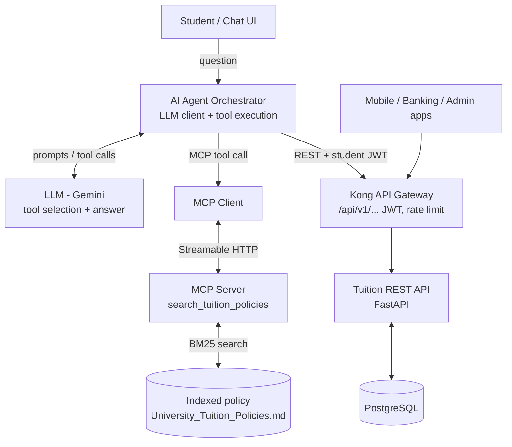

# AI Tuition Assistant — SE 4458 Midterm (Group 1)

A conversational assistant for students asking about tuition deadlines, installment eligibility, payment rules, balances and payments. It is built from four mandatory components:

1. An **LLM-powered AI Agent** that uses real LLM tool calling (Gemini through the OpenAI-compatible API).
2. An **MCP Server** (official MCP Python SDK) that exposes `search_tuition_policies(query)` over an indexed copy of `University_Tuition_Policies.md`.
3. A **Tuition REST API** with a **PostgreSQL** database. All six operations are implemented, protected with JWT, and documented in Swagger.
4. A **Kong API Gateway** that every REST request goes through. This includes the agent's own calls.

> **Student:** _<your name / student number>_ · **Demo video:** _<link>_ · **Gateway URL:** https://api-gateway.salmonmoss-766227b4.swedencentral.azurecontainerapps.io · **Chat UI:** https://tuition-agent.salmonmoss-766227b4.swedencentral.azurecontainerapps.io

### Requirements checklist (where to find each item)

| Requirement | Where |
|---|---|
| Real LLM tool calling, agent executes the calls | [§7](#7-ai-agent), `agent/agent.py`, `agent/llm.py` |
| 3 agent scenarios (MCP-only, REST-only, combined) + tool trace | [§7](#7-ai-agent), `docs/screenshots/1-…3-*.png`, `docs/screenshots/agent-trace.jsonl` |
| Payment only after explicit confirmation (confirmed simulated payment) | [§7](#7-ai-agent), `docs/screenshots/4-…6-*.png` |
| Real MCP SDK server, `search_tuition_policies(query)`, chunking + index | [§6](#6-mcp-server-and-indexing), `mcp_server/`, `docs/mcp-tool-schema.json` |
| 3 distinct MCP retrieval queries | [§6](#6-mcp-server-and-indexing), `docs/screenshots/mcp-retrieval-tests.txt` |
| REST APIs (6 operations), versioned, business rules | [§3](#3-rest-api), `tuition_api/` |
| Swagger UI / OpenAPI | [Azure gateway /docs](https://api-gateway.salmonmoss-766227b4.swedencentral.azurecontainerapps.io/docs), [`docs/openapi.json`](docs/openapi.json), `docs/screenshots/swagger.png`, `cloud-swagger.png` |
| API Gateway: routes, protected route, error response, per-student rate limit | [§4](#4-api-gateway-kong), `gateway/kong.yml.template`, `docs/screenshots/gateway-smoke-test.txt` |
| JWT auth, no access to other students' data | [§5](#5-authentication-and-authorization) |
| Server database + ER model | PostgreSQL, [`docs/er-diagram.md`](docs/er-diagram.md), [`docs/er-diagram.png`](docs/er-diagram.png) |
| Unit tests (success + failure per operation, no cloud/LLM) + evidence | [§8](#8-unit-tests), `docs/screenshots/tests.png` |
| Cloud deployment (Azure) + URLs | [§9](#9-cloud-deployment-azure), `docs/screenshots/cloud-*` |
| LLM cost / low-cost testing | [§10](#10-llm-cost-and-low-cost-testing) |
| Assumptions | [§11](#11-assumptions) |
| Test data + steps to reproduce | [§2](#2-run-locally-docker), `samples/tuition_batch.csv` |

---

## 1. Architecture



PNG version: [`docs/architecture.png`](docs/architecture.png). Data model: [`docs/er-diagram.md`](docs/er-diagram.md) / [`docs/er-diagram.png`](docs/er-diagram.png).

**Agent workflow.** The user asks a question. The LLM selects tools. The agent then executes the MCP and/or REST calls, sending REST calls through the gateway. The tool results go back to the LLM, which gives a grounded answer with policy section references.

The LLM never calls a backend directly. It can only *request* tools, and the agent (`agent/agent.py`) executes them. The MCP path does not pass through the API Gateway.

| Folder | What it is |
|---|---|
| `tuition_api/` | REST API (FastAPI, SQLAlchemy, PostgreSQL), JWT auth, business logic, 34 unit tests |
| `mcp_server/` | MCP server, chunking and BM25 indexer, the policy document, 13 tests |
| `agent/` | AI agent (LLM tool calling, MCP client, gateway client), web chat and CLI, 24 tests |
| `gateway/` | Kong DB-less declarative config (`kong.yml.template`) and config tests |
| `deploy/azure/deploy.sh` | One-command Azure deployment script |
| `docs/` | `openapi.json`, ER diagram, architecture diagram, `mcp-tool-schema.json`, screenshots and logs |
| `scripts/smoke_test.py` | End-to-end check through the gateway (evidence for the gateway and payments) |
| `scripts/mcp_retrieval_demo.py` | Retrieval queries against the running MCP server through a real MCP client |
| `scripts/run_tests.sh` | Runs every unit-test suite |
| `samples/tuition_batch.csv` | CSV for Add Tuition – Batch |

---

## 2. Run locally (Docker)

Requirements: Docker Desktop and a free Gemini API key from <https://aistudio.google.com/apikey>.

```bash
cp .env.example .env          # then put your key into LLM_API_KEY and a random JWT_SECRET
docker compose up --build
```

| What | URL |
|---|---|
| API Gateway (all REST) | http://localhost:8000/api/v1/... |
| Swagger UI (through the gateway) | http://localhost:8000/docs |
| MCP server | http://localhost:8001/mcp |
| Chat UI | http://localhost:8080 |

The Tuition API container has **no published port**, so it can be reached **only through the gateway**. In addition, the API rejects every request that does not carry the gateway's shared secret (see §4, "Gateway-only enforcement").

### Demo accounts and test data (seeded automatically)

| Username | Password | Role | Notes |
|---|---|---|---|
| `20230001` | `Student123!` | student | 2026-SPRING paid; **2026-FALL balance 3,000 USD**. This is the example from the assignment. |
| `20230002` | `Student123!` | student | 2026-FALL 3,000 USD, 1,000 already paid |
| `20230003` | `Student123!` | student | fully paid |
| `20230004` | `Student123!` | student | 2,250 USD (25% merit scholarship) |
| `20230005` | `Student123!` | student | 500 USD unpaid from 2026-SPRING, plus 2026-FALL |
| `20230006` … `20230025` | `Student123!` | student | extra rows to demonstrate paging |
| `bankapp` | `Bank123!` | bank | Banking App system account (any student) |
| `admin` | `Admin123!` | admin | University admin web site |

Reset the data with `docker compose down -v && docker compose up --build`.

---

## 3. REST API

Swagger UI: `<gateway>/docs`. The OpenAPI file is at [`docs/openapi.json`](docs/openapi.json).

| Client | Operation | Method and route (through the gateway) | Auth | Paging |
|---|---|---|---|---|
| — | Login | `POST /api/v1/auth/login` | public | – |
| University Mobile App | Query Tuition | `GET /api/v1/mobile/tuition/{studentNo}?term=` | **NO** (limited to 3 calls per student per day) | NO |
| Banking App | Query Tuition | `GET /api/v1/banking/tuition/{studentNo}?term=` | **YES** (student: own record only; bank: any) | NO |
| Banking App | Pay Tuition | `POST /api/v1/banking/payments` | **YES** | NO |
| Admin | Add Tuition | `POST /api/v1/admin/tuition` | **YES** (admin) | NO |
| Admin | Add Tuition – Batch | `POST /api/v1/admin/tuition/batch` (multipart CSV) | **YES** (admin) | NO |
| Admin | Unpaid Tuition Status | `GET /api/v1/admin/tuition/unpaid?term=&page=&pageSize=` | **YES** (admin) | **YES** |

**Term vs. overall balance (contract).** Query Tuition always returns the per-term breakdown in `terms[]`.
- Without `?term=`, `tuitionTotal` and `balance` are the **OVERALL** sums (`"scope": "OVERALL"`).
- With `?term=2026-FALL`, they are for that term only (`"scope": "TERM"`).

```json
{ "studentNo": "20230001", "fullName": "Ayse Yilmaz", "currency": "USD",
  "tuitionTotal": 5800.0, "balance": 3000.0, "scope": "OVERALL",
  "terms": [ {"term": "2026-FALL", "tuitionTotal": 3000.0, "paidAmount": 0.0, "balance": 3000.0, "status": "UNPAID"},
             {"term": "2026-SPRING", "tuitionTotal": 2800.0, "paidAmount": 2800.0, "balance": 0.0, "status": "PAID"} ] }
```

**Pay Tuition** request and response:
- Request: `{"studentNo","term","amount","transactionId"}`.
- Response: `{"status":"SUCCESS","paidAmount","remainingBalance",...}`.
- The payment is simulated; there is no card processing.
- Partial and full payments are accepted.
- An amount larger than the balance is rejected with `422 AMOUNT_EXCEEDS_BALANCE`.
- A duplicate `transactionId` is rejected with `409 DUPLICATE_TRANSACTION`, and the balance does not change. The transaction ID acts as the idempotency key from Policy Section 7.4.
- A term that is already fully paid is rejected with `409 ALREADY_PAID`.

**Add Tuition: duplicate-handling rules**
- `(studentNo, term)` is unique.
- If the pair does not exist yet, the record is created (`201 CREATED`). Unknown students are created automatically.
- If it exists, the amount is updated (`200 UPDATED`). Payments already made are kept.
- The new amount may not be lower than the amount already paid (`409 AMOUNT_BELOW_PAID`).
- Each student has one billing currency. A different currency is rejected (`409 CURRENCY_MISMATCH`).

**Add Tuition – Batch**
- The CSV header must be `studentNo,term,amount,currency`.
- Every row is validated and saved in its own savepoint, so a bad row never undoes the good rows.
- The response contains `totalRows`, `successCount`, `failureCount` and a per-line result with an error reason.
- Rows are applied in file order. If the same `(studentNo, term)` appears twice, the later row updates the earlier one.

**Versioning.** Every route is under `/api/v1`. A breaking change would be added as `routers/v2.py`, mounted at `/api/v2` and routed by the gateway, while v1 keeps working.

**Errors.** Errors always use the same shape: `{"error": {"code": "...", "message": "..."}}`. Validation errors also carry `details`.

---

## 4. API Gateway (Kong)

- **Gateway URL (Azure):** https://api-gateway.salmonmoss-766227b4.swedencentral.azurecontainerapps.io (Swagger: https://api-gateway.salmonmoss-766227b4.swedencentral.azurecontainerapps.io/docs). Locally it is `http://localhost:8000`.
- **Configuration:** [`gateway/kong.yml.template`](gateway/kong.yml.template). This is Kong 3.9 in DB-less mode, and the same file is used locally and in Azure.

| Public route | Upstream | Gateway policy |
|---|---|---|
| `POST /api/v1/auth/*` | tuition-api | public |
| `GET /api/v1/mobile/tuition/*` | tuition-api | public, **rate-limiting: 3 per day, keyed by student number** |
| `GET,POST /api/v1/banking/*` | tuition-api | **JWT required** (HS256, `iss` and `exp` verified) |
| `GET,POST /api/v1/admin/*` | tuition-api | **JWT required**. The admin role is then checked by the API. |
| `GET /docs`, `/openapi.json` | tuition-api | public (Swagger UI) |

**Per-student rate limit (not per IP).** A `pre-function` plugin copies `{studentNo}` from the path into an `X-Student-No` header, overwriting any value the client sent. The `rate-limiting` plugin then counts by that header.

The API keeps a second, persistent counter in the `api_usage` table, keyed by student number and the Europe/Istanbul date. This way the rule holds even if the gateway restarts.

**Gateway-only enforcement (the API cannot be called around the gateway).** Kong's `request-transformer` plugin removes any client-supplied `X-Gateway-Secret` header and adds the real shared secret to every request it proxies. The Tuition API rejects every request without the correct value (constant-time comparison) with:
```
403 {"error": {"code": "GATEWAY_REQUIRED", "message": "Direct access is not allowed; call the API through the API Gateway"}}
```
Only `/health` (platform health probe) is exempt. The secret is stored as an Azure Container Apps secret for both apps. This works the same locally and in the cloud and is covered by unit tests.

**Example error response from the gateway** (protected route without a token):

```
GET /api/v1/banking/tuition/20230001     -> HTTP/1.1 401 Unauthorized
{"message":"Unauthorized"}
```

The 4th mobile query for the same student on the same day returns **429**:
```
{"message":"Query Tuition is limited to 3 calls per student per day"}
```

Run `python scripts/smoke_test.py <gateway-url>` to print all of this as evidence. Recorded output (local run through Kong): [`docs/screenshots/gateway-smoke-test.txt`](docs/screenshots/gateway-smoke-test.txt). It shows 401 without a token, 200 with a token, 403 for another student, 200/200/200/**429** for the 4th mobile query, 201 then 409 for a duplicate transaction ID, and the admin operations.

---

## 5. Authentication and authorization

- `POST /api/v1/auth/login` issues an **HS256 JWT** with the claims `iss=tuition-auth`, `sub`, `role` (student/bank/admin), `student_no` and `exp` (60 min). Passwords are stored as PBKDF2-SHA256 hashes.
- The token is checked twice. **Kong** checks the signature and expiry at the edge. The **API** checks them again and also enforces roles (defense in depth).
- A **student** token can read and pay only that student's own record. Any other student number gets **403**.
- A **bank** token can access any student, because the Banking App is a trusted system. **Admin** operations need the `admin` role.
- **The AI Agent cannot leak other students' data.** It always calls the API with the **logged-in student's own JWT**, and its REST tools have **no student-number parameter**. A prompt like "show me 20230002's balance" still returns only the user's own data, and the API would answer 403 anyway. This is covered by tests.

---

## 6. MCP server and indexing

- **SDK:** the official `mcp` Python SDK (v2, `MCPServer`), using the Streamable HTTP transport at `/mcp`.
- **Tool schema:** see [`docs/mcp-tool-schema.json`](docs/mcp-tool-schema.json).

```
search_tuition_policies(query: string, top_k: integer = 3)
-> { "document": "University_Tuition_Policies.md", "document_id": "UNI-TUITION-2026-01", "query": "...",
     "matches": [ { "section": "3.2", "heading": "Number and size of installments",
                    "reference": "Section 3.2 - Number and size of installments",
                    "parent_section": "3. Installment policy", "score": 2.57, "text": "An approved balance may ..." } ] }
```

This response follows the format suggested in Section 9 of the policy document: section ID, heading, document ID and text.

**Indexing approach** (`mcp_server/indexer.py`):
1. **Chunking:** every `### N.M` subsection is one chunk, so every hit has a citable section ID. A `## N.` section without subsections, such as 1 or 9, becomes a single chunk. This gives 25 chunks.
2. **Full-text index:** Okapi BM25 (k1=1.5, b=0.75) over lower-cased tokens. Stop-words are removed, tokens are lightly stemmed, and a small synonym map is applied (instalment → installment, due → deadline, penalty → late, ...). Section and parent headings are repeated to boost them.
3. **Indexed once, not per question:** `python indexer.py` runs during the Docker build and writes `data/index.json`. The server loads this file once at start-up. Embeddings were not needed, since full-text search is allowed.

**Three distinct retrieval tests.** They run as unit tests (`mcp_server/tests/test_mcp.py`) and, as evidence, against the **running** MCP server through a real MCP client:
```bash
docker compose run --rm -v ./scripts:/scripts agent python /scripts/mcp_retrieval_demo.py http://mcp:8001/mcp
```
Recorded output: [`docs/screenshots/mcp-retrieval-tests.txt`](docs/screenshots/mcp-retrieval-tests.txt).

| Query | Top section returned |
|---|---|
| `Fall tuition deadline` | 8.1 When is the Fall tuition deadline? (followed by 2.1 Fall term) |
| `installment eligibility` | 3.1 Eligibility |
| `late fee` | 4.1 Late fee rule (followed by 4.2 Example, 4.3 Exceptions) |
| `early withdrawal refund` | 6.1 Early withdrawal |
| `duplicate payment submissions` | 7.4 Duplicate submissions |

---

## 7. AI Agent

- **Code:** `agent/agent.py`.
- **LLM:** any OpenAI-compatible chat-completions endpoint with `tools`. The default is Google **Gemini**. `LLM_MODEL` takes a comma-separated fallback list (`gemini-3-flash-preview,gemini-3.5-flash-lite,gemini-flash-lite-latest,gemini-3.5-flash`): if a model is unavailable (HTTP 404/429/5xx) or times out, the next one is used. The model that answered is recorded in the trace.

| Tool exposed to the LLM | Executed by the agent as |
|---|---|
| `search_tuition_policies(query)` | MCP client, then the MCP server |
| `get_my_tuition(term?)` | `GET /api/v1/banking/tuition/{own studentNo}` through the gateway, using the student's JWT |
| `pay_tuition(term, amount)` | **Only creates a pending payment.** No API call is made at this point. |

**Payment confirmation (enforced in code, Policy Sections 7.2 and 7.3):**
1. When the LLM calls `pay_tuition`, the agent loads the live term balance and checks that `0 < amount ≤ balance`.
   If the student has open balances in **more than one term** and did not name the term in their own message, the payment is not prepared (`NEEDS_TERM_CHOICE`) and the assistant asks which term. The model cannot pick one by itself.
2. The agent stops the LLM loop and shows a **code-generated** confirmation with the **student, term, current balance, amount and remaining balance**. The LLM cannot reword it or claim the payment is done.
3. `POST /api/v1/banking/payments` is called **only if the student's next message is an explicit confirmation** (`yes`, `evet`, `confirm`, `onaylıyorum`, ...). Any other reply cancels the payment.
4. The API result (success or error) goes back to the LLM so it can write the final answer.

**Other policy rules in the prompt:** installments are *subject to approval* (Section 3.4), so the assistant never promises approval. Fees and scholarships are reported only if they appear in the live record (Section 5.2).

**Tool trace.** Every answer comes with a trace showing the tool name, input, result, timing and the final answer. REST entries also show `via`, the gateway URL the call went through. The trace is shown in the chat UI, printed by `cli.py`, and appended to `agent/logs/trace.jsonl` (one JSON line per question: question, trace, final answer). The log of the recorded demo run is in [`docs/screenshots/agent-trace.jsonl`](docs/screenshots/agent-trace.jsonl).

### The three required scenarios (plus payment)

Recorded with student **20230005** (open balances in two terms: 2026-SPRING 500 USD, 2026-FALL 3,000 USD).

| # | Student message | Tools the LLM chose | Evidence |
|---|---|---|---|
| 1 | *When is the payment deadline?* | MCP only: `search_tuition_policies` | [1-mcp-only.png](docs/screenshots/1-mcp-only.png) |
| 2 | *What is my balance?* | REST only: `get_my_tuition` (through the gateway) | [2-rest-only.png](docs/screenshots/2-rest-only.png) |
| 3 | *Can I pay my outstanding balance in installments?* | REST + MCP in the same step | [3-combined.png](docs/screenshots/3-combined.png) |
| 4 | *Pay 1000 of my balance* | REST (balance) → the assistant asks which term (two open terms) | [4-payment-ask-term.png](docs/screenshots/4-payment-ask-term.png) |
| 5 | *2026-FALL* | `pay_tuition` → code-generated confirmation, nothing charged | [5-payment-confirm.png](docs/screenshots/5-payment-confirm.png) |
| 6 | *yes* | explicit confirmation → `POST /api/v1/banking/payments` → 201 | [6-payment-success.png](docs/screenshots/6-payment-success.png) |

CLI version of the same scenarios, which prints the full trace:
```bash
docker compose run --rm agent python cli.py --user 20230001 --password Student123! \
  -q "When is the payment deadline?" -q "What is my balance?" \
  -q "Can I pay my outstanding balance in installments?" -q "Pay 1000 of my balance" -q "yes"
```

---

## 8. Unit tests

All tests run automatically **without the cloud, the gateway or a live LLM**:
- The Docker test runner runs the API tests on **PostgreSQL** (a separate `tuition_test` database that is created automatically; the demo data is not touched). Without `TEST_DATABASE_URL`, for a quick run on a laptop, they fall back to in-memory SQLite. The production database is always PostgreSQL.
- The agent tests use a scripted LLM, the real API in-process, and the real MCP server over an in-memory MCP transport.

Run all suites (76 tests) with nothing installed except Docker:
```bash
docker compose --profile test run --rm tests
```
or with Python 3.12 installed: `sh scripts/run_tests.sh`. Per component:

| Suite | Tests | What is covered |
|---|---|---|
| `tuition_api` | 34 | every REST operation: success + failure/edge cases |
| `mcp_server` | 13 | chunking, retrieval queries, MCP protocol round-trip |
| `agent` | 24 | 3 scenarios, identity, payment confirmation gate, term choice, LLM fallback |
| `gateway` | 5 | versioned routes, JWT on protected routes, rate-limit key |

Coverage per operation (at least one success and one failure each): login; mobile query (success, term filter, 429 on the 4th call, 404, 422); banking query (401, own record, 403 for another student, bank access, expired or forged token); pay (partial, full, duplicate transaction ID, amount over the balance, already paid, other student, 0 or negative amount, unknown term, 401); add tuition (create, update, below paid amount, currency mismatch, 403, 422); batch (mixed file with counts, bad header, 403); unpaid (paging, page past the end, invalid pageSize, 403).

Evidence of a successful run (API tests on PostgreSQL): [`docs/screenshots/tests.png`](docs/screenshots/tests.png), full output in [`docs/screenshots/tests-output.txt`](docs/screenshots/tests-output.txt).

---

## 9. Cloud deployment (Azure)

| Component | Azure service |
|---|---|
| Tuition REST API | Azure Container Apps. Accepts only requests that carry the gateway secret; direct calls get **403 GATEWAY_REQUIRED** |
| API Gateway | Kong on Azure Container Apps (external) |
| MCP server | Azure Container Apps (external, `/mcp`) |
| AI Agent and chat UI | Azure Container Apps (external) |
| Database | Azure Database for PostgreSQL Flexible Server (Burstable B1ms, PostgreSQL 16) |
| Images | Azure Container Registry (Basic). Built with `az acr build`, or built locally with Docker and pushed when ACR Tasks are not allowed (Azure for Students). |

Deployment (Azure Cloud Shell, Bash). The script is idempotent: run it again after any interruption.
```bash
git clone https://github.com/borayldz3919-blip/se4458-ai-tuition-assistant.git && cd se4458-ai-tuition-assistant
export LLM_API_KEY=<gemini key>
LOCATION=swedencentral bash deploy/azure/deploy.sh
```
**Azure for Students note.** ACR Tasks (`az acr build`) are blocked on student/free-credit subscriptions (`TasksOperationsNotAllowed`). The script detects this, stops after creating the registry, database and environment, and prints the exact `docker login / tag / push` commands. Run them on your own computer (images built with Docker Desktop), then run the same deploy command again; it re-uses everything and creates the four container apps.

Deployed URLs (Azure, region Sweden Central):

| Component | URL |
|---|---|
| API Gateway (all REST, `/api/v1/...`) | https://api-gateway.salmonmoss-766227b4.swedencentral.azurecontainerapps.io |
| Swagger UI (through the gateway) | https://api-gateway.salmonmoss-766227b4.swedencentral.azurecontainerapps.io/docs |
| MCP server (Streamable HTTP) | https://mcp-server.salmonmoss-766227b4.swedencentral.azurecontainerapps.io/mcp |
| Chat UI (AI agent) | https://tuition-agent.salmonmoss-766227b4.swedencentral.azurecontainerapps.io |
| Tuition API (direct calls rejected: 403 `GATEWAY_REQUIRED`) | https://tuition-api.salmonmoss-766227b4.swedencentral.azurecontainerapps.io |

Demo login for the chat: `20230005` / `Student123!` (see §2 for all demo accounts).

**Cloud evidence**
- Gateway, through Kong in Azure: [`docs/screenshots/cloud-gateway-smoke-test.txt`](docs/screenshots/cloud-gateway-smoke-test.txt). Shows the direct call to the API rejected with 403 `GATEWAY_REQUIRED`, 401 without a token, 200 with a token, 403 for another student, 200/200/200/**429** mobile limit, 201 then 409 duplicate transaction, and the admin operations.
- MCP retrieval against the cloud MCP server: [`docs/screenshots/cloud-mcp-retrieval-tests.txt`](docs/screenshots/cloud-mcp-retrieval-tests.txt).
- Swagger UI served through the Azure gateway: [`cloud-swagger.png`](docs/screenshots/cloud-swagger.png).
- Chat on Azure (address bar visible): [`cloud-chat-combined.png`](docs/screenshots/cloud-chat-combined.png) (REST via the Azure gateway + MCP), [`cloud-payment-confirm.png`](docs/screenshots/cloud-payment-confirm.png), [`cloud-payment-success.png`](docs/screenshots/cloud-payment-success.png).

Cost: everything fits in the Azure for Students credit (PostgreSQL B1ms plus 4 small container apps plus ACR Basic). Delete the resources afterwards with `az group delete -n rg-tuition-assistant`.

---

## 10. LLM cost and low-cost testing

- **Default provider:** Gemini via `generativelanguage.googleapis.com/v1beta/openai/`. Its **free tier** needs no credit card.
- **Usage per question:** typically 2 LLM calls of about 1.5k input tokens each, so a full demo is free. Token usage and the model that answered are recorded in the trace (`usage`). The payment confirmation step needs no extra LLM call.
- **Free-tier overload:** free models are sometimes overloaded (HTTP 503). `LLM_MODEL` is a fallback list, so the agent automatically tries the next model. `scripts/check_llm.py` shows which models answer with your key.
- **Switching provider:** change `LLM_BASE_URL`, `LLM_MODEL` and `LLM_API_KEY`. OpenAI, GitHub Models, Groq and Ollama all work with no code change.
- **Unit tests never call an LLM.** They use `ScriptedLLM`, so the whole test suite costs nothing.
- **Cloud cost:** Azure for Students credit (PostgreSQL Burstable B1ms, 4 small Container Apps with 1 replica each, ACR Basic). Roughly 20-30 USD per month while running; delete the resource group after grading.

---

## 11. Assumptions

**Policy document**
- The policy document is the provided fictitious `University_Tuition_Policies.md`. It is used only through MCP and is **not** the tuition database.
- Installments: the policy says plans need approval and that a partial payment is not an approved plan (Section 3.4). The system therefore records partial payments but does not store installment approvals. The assistant explains eligibility (balance of at least $300) and the possible split, but never claims approval.
- Late fees (Section 4) and scholarships (Section 5) are explained from the policy only. They are not calculated or posted automatically, because the policy says the document does not post fees.
- Payment posting delay (Section 2.3): simulated payments are recorded instantly. A real bank channel could take up to two business days.

**Money and currency**
- All demo tuition is in **USD**. Each student has a single billing currency.
- Amounts are `NUMERIC(12,2)` and rounded half-up to the cent. JSON returns them as numbers.

**Data formats**
- Terms use the format `YYYY-FALL | YYYY-SPRING | YYYY-SUMMER`.
- Student numbers are 6 to 12 digits.

**Rate limit and errors**
- The mobile query limit is **3 calls per student per calendar day**. The API counts by the Europe/Istanbul date; Kong's counter uses its own day window. Calls for unknown student numbers also count toward that key.
- Gateway errors use Kong's format `{"message": ...}`. API errors use `{"error": {"code","message"}}`.

**API contract**
- Add Tuition – Batch is an administrative operation, so it requires the `admin` role even though the auth table in the assignment lists only Add Tuition.
- REST was chosen as the API style (no alternative style), exposed only through the gateway.

**Identity**
- Students log in with their student number. The Banking App uses a `bank` system account. Admins use an `admin` account.
- JWTs are HS256 with a secret shared between the API and Kong. In production this would be RS256 with a JWKS endpoint (OAuth 2.0).
- Tokens expire after 60 minutes; the chat user then logs in again.

**AI agent**
- If a student has open balances in more than one term and does not name the term, the agent asks which term instead of choosing one (enforced in code).
- The assistant answers in English unless the student writes in Turkish.

**Deployment**
- The agent keeps chat sessions in memory, so each container app runs one replica (`max-replicas 1`).
- Kong's rate-limit counter is `policy: local`, which matches one replica. The persistent counter in the API covers restarts.
- The MCP server is publicly reachable without auth because it serves only public policy text.
- **API network exposure:** the first deployment used *internal-only* ingress for the Tuition API, but in this Azure Container Apps environment the other apps could not reach internal apps (Kong got 404 for the internal FQDN and a DNS error for the short app name). The API therefore has normal ingress and enforces "gateway only" at the application level with the gateway's shared secret (direct calls: 403 `GATEWAY_REQUIRED`, evidence in `docs/screenshots/cloud-gateway-smoke-test.txt`). JWT and roles are still checked again by the API.

---

## 12. Demo video and evidence

- **Video:** _<link>_ (about 5 min). It shows the architecture, the three agent scenarios with traces, three MCP retrieval tests, a protected gateway route (401/200), the 429 rate limit, a confirmed simulated payment, and running the unit tests.

| Evidence | File |
|---|---|
| Agent scenarios (MCP-only, REST-only, combined) | `docs/screenshots/1-mcp-only.png`, `2-rest-only.png`, `3-combined.png` |
| Payment: term question, confirmation, success | `docs/screenshots/4-payment-ask-term.png`, `5-payment-confirm.png`, `6-payment-success.png` |
| Agent tool trace log (tool, input, result, final answer) | `docs/screenshots/agent-trace.jsonl` |
| Three distinct MCP retrieval queries | `docs/screenshots/mcp-retrieval-tests.txt` |
| Gateway: protected route, error response, 429, payment, admin | `docs/screenshots/gateway-smoke-test.txt` |
| Swagger UI through the gateway | `docs/screenshots/swagger.png` |
| Unit tests run (API tests on PostgreSQL) | `docs/screenshots/tests.png`, full output `docs/screenshots/tests-output.txt` |
| Cloud deployment (Azure) | `docs/screenshots/cloud-gateway-smoke-test.txt`, `cloud-mcp-retrieval-tests.txt`, `cloud-chat-combined.png`, `cloud-payment-confirm.png`, `cloud-payment-success.png`, `cloud-swagger.png` |
