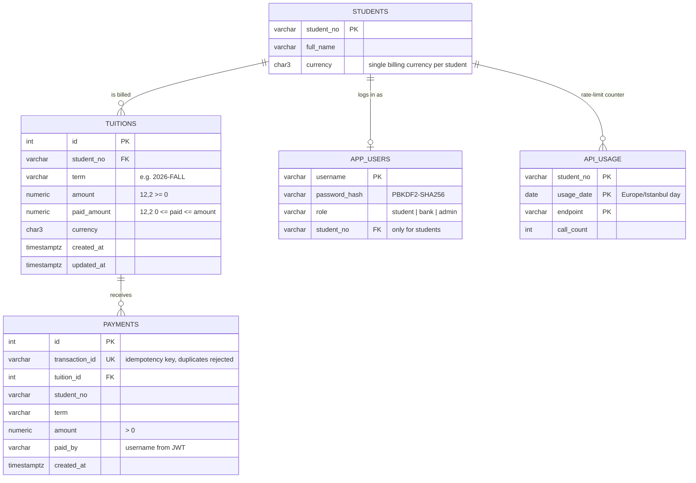

# ER / Data Model

PostgreSQL 16 (Azure Database for PostgreSQL Flexible Server in the cloud, `postgres:16-alpine` locally).
Tables are created by SQLAlchemy at API start-up (`tuition_api/app/models.py`).

Constraints
- `UNIQUE (student_no, term)` on `tuitions`: one tuition record per student per term (Add Tuition upserts).
- `UNIQUE (transaction_id)` on `payments`: duplicate transaction IDs are rejected (HTTP 409).
- `CHECK (paid_amount <= amount)`: a payment can never exceed the balance, even under concurrency
  (the API also locks the tuition row with `SELECT ... FOR UPDATE`).
- Balance is derived: `amount - paid_amount` (never stored twice).
